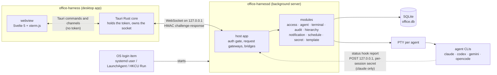
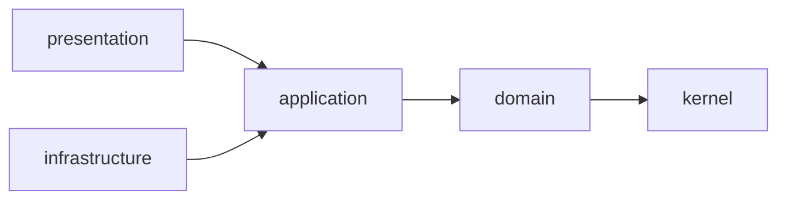
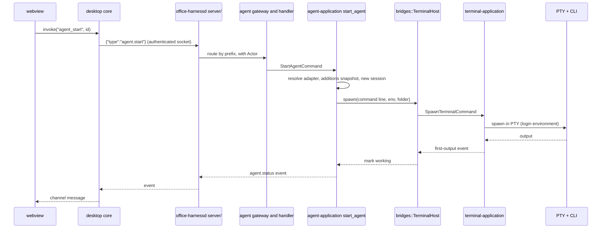

# Architecture Specification

Status: current with `main` · Date: 2026-11-28. Product scope is in [PRD.md](PRD.md). The behavior contracts are the living specs, one file for each capability under [`specs/`](../specs/), and the change specs under [`specs/changes/`](../specs/changes/). The first design of the server and the terminal is beside change 0001: [research.md](../specs/changes/archive/0001-office-server-and-terminal/research.md), [data-model.md](../specs/changes/archive/0001-office-server-and-terminal/data-model.md), and [contracts/client-protocol.md](../specs/changes/archive/0001-office-server-and-terminal/contracts/client-protocol.md). Each later change keeps its own design files beside its spec.

This file describes the code as it is on `main`. When the code and this file differ, the code is right: fix this file.

Mark:
- **Decided** means that the owner made the decision.

## System Overview

office-harness has two programs that run on the user's machine:

- `office-harnessd` is the background server. It runs every agent CLI in its own pseudo-terminal (PTY), keeps the office state in one SQLite database, and serves clients over a loopback WebSocket. It also takes the status reports of the CLI hooks on one loopback HTTP route. It runs while the user is logged in, whether or not a window is open.
- `office-harness` is the desktop app, built with Tauri v2. Its Rust core is the only process that talks to the server. Its webview (Svelte 5) shows the office and the live terminals.

Each program is a **modular monolith**: one Cargo workspace of small Rust crates, split by business module first and by Clean Architecture layer inside each module. The pattern follows one rule: modules never depend on one another, and the host app is the only place that wires them together.



**Decided** (2026-11-15):
- the stack: a Rust server, Tauri v2, xterm.js, SQLite, and a loopback WebSocket with a token;
- Svelte with TypeScript for the webview;
- the license, AGPL-3.0-or-later.

Every other decision in this document was made while the product was built, and the code holds it.

## Architectural Style

**Modular monolith with Clean Architecture in each module.**

| Property | Decision |
| --- | --- |
| Deployment | Two binaries: `office-harnessd` and the Tauri app. The installer bundles the server as a Tauri sidecar. The server registers itself as a per-user login item. |
| Process model | The server is one process with one Tokio runtime. It runs each agent CLI as a child process in its own PTY. |
| Database | One SQLite file. Each module owns the tables that carry its prefix, and each module runs its own migrations. |
| Composition | Constructor injection at one composition root per program. |
| Module boundary | The Cargo dependency graph enforces it, not a runtime registry. |
| Clients | The only client is the desktop app. A later client (R5 remote machines, parked as change 0006) would use the same protocol and the same token proof. |

## Module Pattern

Each business module is a set of separate Cargo crates, one for each Clean Architecture layer. All nine modules have all four layers.

| Layer | Crate name | Contents |
| --- | --- | --- |
| `domain` | `<module>-domain` | `entities/`, `value_objects/`, `enums/`, `events/`, `services/`, `errors/`, and invariants. No I/O. A module has the folders that it needs. |
| `application` | `<module>-application` | `common/` (ports in `interfaces/`, `models/`, `errors/`), `commands/<use_case>/`, and `queries/<use_case>/`. A module with no commands or no queries has no such folder, and `schedule` and `template` keep their use cases in `services/`. |
| `infrastructure` | `<module>-infrastructure` | `persistence/` (`repositories/`, `migrations/`) and outbound adapters (PTY host, CLI adapters, git, file stores, the secret vault). |
| `presentation` | `<module>-presentation` | `handlers/` (the protocol messages that the module answers), `contracts/` (request, response, and event bodies), `mappings/`, and the request prefixes that the module owns. |

Package names use the form `<module>-<layer>`. The Rust import path is `<module>_<layer>`. For example, the package `agent-domain` is imported as `agent_domain`.

Presentation here means the protocol surface, not a screen. A module's `presentation` crate declares which protocol messages it answers. The host app owns the socket and sends each message to the module that owns its prefix.

### Modules

Boundaries follow the spec entities. A new module is added when a change needs a new boundary.

| Module | Owns | Request prefixes | Change |
| --- | --- | --- | --- |
| `access` | The office token, the challenge and proofs, token regeneration, and the owner-only file rules | `token.` | 0001 |
| `agent` | Agents, projects, office additions, sessions, the status state machine, settings, the CLI adapters (`claude`, `codex`, `gemini`, `opencode`, generic), own git worktrees and their dependency links, the read-only file view, and finished temps | `agent.`, `project.`, `session.`, `settings.` | 0001, 0010, 0011, 0016, 0018, 0019, 0020, 0021, 0024 |
| `terminal` | PTY processes, the server-side screen emulator, the capped output store, terminal-query answers, attach, input, resize, and the process inspection that the sweep reads | `terminal.` | 0001, 0017 |
| `audit` | Action record entries: actor, target, action, time, and result | `agent.actions` (one request) | 0001, 0007 |
| `hierarchy` | Roles, teams, the parent tree, directives, upward reports, subtree reads, and the hold switch | `team.`, `hierarchy.` (and the agent-side `lead` and `subtree` calls) | 0002, 0007, 0012, 0014, 0015 |
| `notification` | Notifications, their read state, and the Needs-you queue | `notification.`, `needs_you.` | 0003, 0008 |
| `schedule` | The person's schedules: repeat and due-time rules, next due times, run history, and the schedule cap | `schedule.` | 0025 |
| `secret` | Sealed secret values and their grants to agents; the store key lives in the OS keyring, with a key file as the fallback | `secret.` | 0026 |
| `template` | Saved agent and team definitions | `template.` | 0009 |
| (later) `machine` | Machines that join the office from another computer | | parked, 0006 |
| (later) `meeting` | Meetings with chosen agents and presets | | parked, 0004 |

The office scene (0005) is a webview module that reads the same entities. It needs no server module of its own.

**Cross-module needs, resolved without a module dependency:**
- **`agent` needs a running terminal.** `agent-application` declares a `TerminalHost` port (spawn, stop, and subscribe to exit and output activity). The host app implements it in `bridges/terminal_host.rs` by calling `terminal-application`. `agent` never names a `terminal` type.
- **`agent` drives its status from terminal activity.** `terminal-application` emits plain events (first output, quiet period, exit code). The bridge turns them into `agent` status commands. For `claude` agents, the status hook reports drive the status instead (see Status Hook Route).
- **Every module writes the action record.** Each writing module declares an `ActionRecorder` port in its own `application` crate. The host app implements it with `audit-application` (`bridges/action_recorder.rs`).
- **Notifications and the Needs-you queue.** Modules that raise events declare their own ports. The bridges `notification_bridge.rs` and `needs_you_bridge.rs` turn the events into `notification` commands.
- **Directives, holds, schedules, secrets, and temps cross modules the same way.** Each has bridges in the host app (`directive_bridges.rs`, `hold_bridges.rs`, `schedule_bridge.rs`, `secret_bridges.rs`, `temp_ender.rs`), and no module names another module's type.
- **The CLI adapters are `agent` infrastructure.** They build command lines and read a CLI's session list without writing anything (0001/FR-021). They know CLIs, not terminals.

## Directory and Crate Structure

```text
office-harness/
├── Cargo.toml                                  # workspace root
├── package.json, bun.lock                      # JavaScript workspace (desktop webview)
├── docs/                                       # PRD.md, ARCHITECTURE.md
├── scripts/                                    # check-boundaries.sh, lint-rust.sh, and others
├── specs/                                      # living specs, one folder for each capability
│   └── changes/                                # change specs: draft and approved, archive/, parked/
└── src/
    ├── kernel/                                 # shared kernel (see Kernel)
    ├── modules/
    │   ├── agent/                              # largest module, shown as the example
    │   │   ├── domain/src/
    │   │   │   ├── entities/                   # agent.rs, project.rs, session.rs, machine.rs, finished_temp.rs
    │   │   │   ├── value_objects/
    │   │   │   ├── enums/                      # agent_status.rs
    │   │   │   ├── services/                   # status_machine.rs
    │   │   │   └── errors/
    │   │   ├── application/src/
    │   │   │   ├── common/interfaces/          # ports: repositories, terminal_host.rs, cli_adapter.rs, action_recorder.rs, clock.rs
    │   │   │   ├── commands/                   # create_agent/, start_agent/, stop_agent/, sleep_agent/, resume_agent/, ...
    │   │   │   └── queries/
    │   │   ├── infrastructure/src/
    │   │   │   ├── persistence/                # repositories/, migrations/
    │   │   │   └── services/                   # cli_adapters/, login_environment.rs, git_worktrees.rs, local_file_view.rs, status_command.rs, ...
    │   │   └── presentation/src/
    │   │       ├── handlers/
    │   │       ├── contracts/                  # requests/, responses/, events/
    │   │       └── mappings/
    │   ├── terminal/                           # same shape; infrastructure/services/pty_host.rs, screen_emulator.rs, output_store.rs
    │   ├── access/  audit/  hierarchy/  notification/  schedule/  secret/  template/
    │   └── ...                                 # each has domain, application, infrastructure, presentation
    │
    ├── shared/                                 # technical crates only (see Shared Technical Crates)
    │   ├── wire/                               # envelope, frame codec, HMAC proof, protocol constants
    │   ├── private-fs/                         # owner-only files and folders on Unix and Windows
    │   └── console-control/                    # Windows console control for stopping a child
    │
    └── apps/
        ├── office-harnessd/                    # the background server
        │   └── src/
        │       ├── main.rs                     # composition root, thin
        │       ├── config/                     # data folder and flags
        │       ├── bootstrap/                  # single-instance lock, migrations, interrupted marking, services, log
        │       ├── server/                     # axum router, upgrade checks, auth gate, request gateways, event hub, hook route
        │       ├── bridges/                    # cross-module port adapters
        │       ├── sweep/                      # the leftover-process sweep after an unclean stop (0017)
        │       └── cli/                        # register, unregister, status, agent calls
        └── desktop/                            # the Tauri app
            ├── src-tauri/src/                  # Rust core: connection.rs, connection/, server_process.rs, commands.rs, channels.rs
            └── src/                            # Svelte 5 webview (see Frontend Folder Structure)
```

**Rust to Clean Architecture mapping.**

| Clean Architecture | This project |
| --- | --- |
| Solution | Cargo workspace (`Cargo.toml` at the root) |
| Projects `X.Domain`, `X.Application`, `X.Infrastructure`, `X.Api` | Crates `<module>-domain`, `-application`, `-infrastructure`, `-presentation`, and the host `office-harnessd` |
| `Common/Interfaces` (ports) | `common/interfaces/` in the application crate |
| `Commands/<UseCase>` with command, handler, and validator | `commands/<use_case>/` with a handler and its tests. A use case with input rules may add a validator (`spawn_terminal/` has one). |
| Controllers | `handlers/` in the presentation crate, plus the request gateways in `office-harnessd/src/server/` |
| `Program.cs` | `main.rs`, `config/`, `bootstrap/` |

## File Organization Inside a Crate

- **Group by kind inside a layer crate, with one folder per use case in `application`.** There is no `features/` level, because the module is already the feature boundary.
- **A file is named after its main type** in snake_case: `create_agent_handler.rs` holds `CreateAgentHandler` and the request and result types of that use case.
- **Input rules** live in a validator where a use case has one, and otherwise in the handler or in the value objects. A validation error names the field (the spec's edge cases).
- **Each folder's `mod.rs` is its public face.** It re-exports the folder's types, so consumers import from the folder.
- **Tests:**
  - Unit tests sit beside the code in `<name>.tests.rs`, attached with `#[cfg(test)] #[path = "..."] mod tests;`.
  - Integration tests go in each crate's `tests/` folder.

## Workspace Configuration

The root `Cargo.toml` picks up module crates by pattern, so adding a module needs no workspace edit:

```toml
[workspace]
resolver = "3"
members = [
    "src/kernel",
    "src/shared/*",
    "src/modules/*/domain",
    "src/modules/*/application",
    "src/modules/*/infrastructure",
    "src/modules/*/presentation",
    "src/apps/office-harnessd",
    "src/apps/desktop/src-tauri",
]
default-members = ["src/apps/office-harnessd"]

[workspace.package]
edition = "2024"
license = "AGPL-3.0-or-later"
publish = false
```

- **Glob members:** Cargo rejects a glob that matches no folder. A glob stays out of the file until its first crate exists.
- **Tests:** CI and every local check use `cargo test --workspace`. A plain `cargo test` only covers the default member.
- **Versions:** third-party versions are fixed in `[workspace.dependencies]`, most of them with an exact `=` pin. A comment names the change that needed each one.
- **Workspace lints:** `unsafe_code = "forbid"`. Three crates lower it to `deny` and allow `unsafe` in marked blocks, because they call Windows or system APIs: `private-fs`, `console-control`, and `terminal-infrastructure`. On top of that, clippy pedantic, plus deny for `unwrap_used`, `expect_used`, and `todo`. `scripts/lint-rust.sh` runs the format check and clippy with the pinned toolchain.

## Dependency Rules

**Cardinal rule: business modules never depend on one another.** No crate of one module appears in another module's manifest.

Within a module the order is strict:



| Crate | May depend on | Must never depend on |
| --- | --- | --- |
| `kernel` | `serde`, `uuid`, `thiserror` | Any module, any app, `tokio`, `axum`, `rusqlite` |
| `<module>-domain` | `kernel`, `serde`, `serde_json`, `thiserror`, `uuid`, `jiff`, `hex`, `zeroize`, `icu_normalizer` (pure value helpers) | Its own outer layers, I/O crates, any other module |
| `<module>-application` | Its own `domain`, `kernel`, `thiserror`, `jiff`, `sha2`, `zeroize` | Its own `infrastructure` and `presentation`, `axum`, `rusqlite`, `portable-pty`, `vt100`, `tokio`, any other module |
| `<module>-infrastructure` | Its own `application` and `domain`, `kernel`, `rusqlite`, `portable-pty`, `vt100`, `tokio`, `sysinfo`, `keyring`, `chacha20poly1305`, and `shared/*` | Its own `presentation`, `axum`, any other module |
| `<module>-presentation` | Its own `application` and `domain`, `kernel`, `serde`, `serde_json`, `uuid`, `jiff`, `base64`, `shared/wire` | Its own `infrastructure`, `rusqlite`, `portable-pty`, any other module |
| `shared/*` | Third-party technical crates | `kernel`, any module, any app |
| `office-harnessd` | Every module's `presentation`, `infrastructure`, and `application` (for port types while wiring), `kernel`, `shared/*`, `axum`, and `tokio` | Nothing; it is the outermost crate |
| `desktop` (`src-tauri`) | `shared/wire`, `tauri` and its plugins, `tokio` | Every module crate, `rusqlite`, `portable-pty` |

The desktop app knows only the wire protocol. It never links server code, so a later remote client (R5) has the same view of the server.

## Kernel

`src/kernel` follows the Shared Kernel pattern: a small subset of the model that several modules agree to share. It holds `AgentId`, `ProjectId`, `ScheduleId`, `Actor` (the user, or an agent), `Timestamp`, `VisibleText`, and `TextRedactor`. A type moves in only when a second module needs it.

**Admission rule.** A type enters only when all three hold:
1. At least two modules need it.
2. It is a domain concept, not a helper.
3. It changes rarely.

**Excluded outright:** helper modules (`utils`, `common`, `helpers`), ports, business rules, framework types, and catch-all error enums.

## Shared Technical Crates

`src/shared/` holds technical capabilities. It is not a layer and not a module. A crate enters only when all of these hold:

1. At least two crates need it.
2. It holds no business vocabulary.
3. It depends on no module and no app.

| Crate | Why it is shared | Users |
| --- | --- | --- |
| `wire` | The request, response, and event envelope, the binary terminal frame codec, the HMAC challenge-response proof, the protocol version, and the paths and limits of the socket and the hook route. Both ends of the socket must agree byte for byte. | `office-harnessd`, module `presentation` crates, `desktop` |
| `private-fs` | Creates files and folders that only the owner can read: mode `0600`/`0700` on Unix, and a protected access list on Windows (0001/FR-009) | `access-infrastructure`, `terminal-infrastructure`, `office-harnessd` bootstrap |
| `console-control` | The Windows console calls: turns Ctrl+C back on for the server so that a stop can reach its children, and the raw input mode of the terminal test fixture. Both are no-ops on other systems. | `office-harnessd`, `terminal-infrastructure` |

Message bodies (`contracts/`) stay in each module's `presentation` crate. For the webview, the desktop core generates the TypeScript types of its own error and connection-state types with `ts-rs` into `src/apps/desktop/src/core/api/generated/`. The request and response bodies of the modules reach the webview as typed wrappers in each webview module's `services/`, not as generated types.

## Composition Root and Request Flow

`src/apps/office-harnessd/src/main.rs` is the only place that selects concrete implementations. It stays thin. It first checks for the two small command paths (the agent call used by the CLI helper, and `register`, `unregister`, and `status`), then loads the configuration, opens the log, builds the services, and serves. In outline:

```rust
async fn run() -> Result<(), StartupError> {
    bootstrap::enable_os_keyring();
    let config = Config::load(env::args_os().skip(1))?;
    let log = bootstrap::open_log(&config)?;
    start_and_wait(&config, &log).await
}
```

**Startup order:**
1. Load the configuration and the data folder.
2. Take the single-instance lock. A second server exits with a clear message.
3. Run each module's migrations, every module on its own ledger.
4. Mark the agents of an unclean stop as `interrupted` (0001/FR-004).
5. Build the infrastructure adapters, the office token, and the terminal runtime.
6. Build the use-case services with the ports injected (the bridges included).
7. Write `server.json`.
8. Bind `127.0.0.1` on a free port and serve.

The leftover-process sweep (0017) runs after the services exist. Requests that start a session wait on its gate until the sweep ends.

### Authentication context

The full rules are in [the client protocol](../specs/changes/archive/0001-office-server-and-terminal/contracts/client-protocol.md#authentication-fr-007-fr-010).

- **Before any module code runs,** the server's `server/` layer:
  - refuses non-loopback peers;
  - refuses an upgrade with a wrong `Host` or with any `Origin`;
  - runs the mutual HMAC challenge-response through `access-application`.
- **On success,** it attaches an `Actor::User` to the connection. Module handlers read the `Actor`; they never see the token.
- **The token never crosses the socket and never enters the webview.** The desktop app's Rust core reads it from the owner-only data folder and proves knowledge of it.
- **What the token protects against:** other OS users, and programs that do not run as the owner. It is not a sandbox against an agent CLI that runs as the same user (spec 0001 A7).

### Request routing

A connection reads each request and sends it by the prefix of its type. `terminal.` goes to the terminal gateway of the connection. Every other prefix goes to the gateway of the module that owns it (`AgentGateway`, `HierarchyGateway`, `HoldGateway`, `NotificationGateway`, `ResumeGateway`, `ScheduleGateway`, `SecretGateway`, `TempGateway`, `TemplateGateway`), and `token.` goes to `access`. The gateways live in `office-harnessd/src/server/*_requests.rs` and call the use cases of the module. An event reaches every connected client through the event hub (`server/event_hub.rs`).

### Request flow: start an agent



### Terminal attach flow

1. The webview asks the core to attach, with its size.
2. The server sends one snapshot frame, built by `terminal-infrastructure` from the server-side emulator. The frame has the scrollback rows, then the screen, then the input modes.
3. Live output frames follow.
4. Keys go back as `terminal.input`.
5. The server answers the terminal's cursor-position and device-attribute queries itself, and the webview drops xterm.js's own automatic answers, so a CLI never gets two answers.

### Status Hook Route

For an agent whose CLI is `claude`, the status comes exactly from the hooks of the CLI, not from a guess on its output (0024).

1. When the server starts a `claude` session, `bridges/status_hook_files.rs` writes an office settings file for the session in the `hooks/` folder of the data folder, and the CLI starts with it. The file holds report-only hooks and the session secret. It never touches the CLI's own configuration (0001/FR-021).
2. A hook posts its event to `POST /v1/hook/{session}` on the loopback address (`server/router.rs`, `server/hook_requests.rs`). The route accepts a report only from the same machine, only with the secret of that session, at most 64 KB, and at most a fixed number of reports for each session in each second.
3. `bridges/hook_status_bridge.rs` and `bridges/hook_sessions.rs` turn a report into a status change, an open permission ask, or a compaction. A session without a report falls back to the estimate from terminal output.
4. When the session ends for any reason, the server revokes its secret and deletes its settings file.

The route is the only HTTP route besides the health check and the WebSocket upgrade.

### Cross-cutting rules

- **No CLI configuration is written (0001/FR-021).** No crate writes into a CLI's configuration folders. Only `agent-infrastructure` reads them, and only for a session list. A test fixture checks that the folders do not change.
- **Login environment (0001/FR-020).** An agent starts with the user's resolved login environment, plus its office additions, minus the server's own variables.
- **No outside connections (0001/FR-005).** No crate depends on an HTTP client. Only `desktop` opens a socket, and only to loopback.
- **Secrets stay out of every store (0026).** A secret value is sealed with a store key from the OS keyring (or a key file), is cleared from memory when dropped, and is replaced by `[secret NAME]` in stored output and command lines.
- **Logs** hold ids, status, and error kinds. They never hold the token, terminal output, prompts, secrets, or environment values.
- **Error contract.** Every failed request returns `{"ok":false,"error":{"code","message"}}` with one of the codes `invalid`, `conflict`, `not_found`, `refused`, or `internal`. The message names the field or entry at fault.

## CQRS Organization

Commands (`commands/`) change state. Queries (`queries/`) only read, and they may return shapes made for display. Handlers call the use-case function directly. There is no mediator and no runtime dispatch by message type inside a module. The only dispatch is the host's routing by message prefix.

## Data Folder and Database

There is one data folder per OS user, chosen by the `directories` crate (or by `--data-folder`), with owner-only access:

```text
<data folder>/
├── office.db            # SQLite, WAL mode
├── token                # office token (access)
├── server.json          # port, pid, protocol, version, start nonce
├── server.lock          # held while the server runs
├── server.log           # the server log
├── secrets.key          # store key file, only where the OS keyring is not used (secret)
├── secret-office-id     # names this office in the keyring (secret)
├── output/<session>.log # capped recent output (terminal)
├── hooks/               # office settings files of claude sessions, one for each session
└── worktrees/           # own git worktrees of agents (agent)
```

- **One database file, one owner per table.** Each module's tables carry its prefix: `agent_`, `audit_`, `hierarchy_`, `notification_`, `schedule_`, `secret_`, `template_`. Each module has its own migration ledger table (`<module>_schema_version`) and its own forward-only migrations, so modules stay independent. SQLite has no schemas, so this replaces the per-module schema that a server database would use. A bridge never joins tables of two modules.
- **Writes run in one transaction per command.** A full disk produces a `storage.error` event, and the agents keep running.
- **Backup and removal:**
  - Stop the server, then copy the data folder to back it up.
  - `office-harnessd unregister` removes the login item.
  - Deleting the data folder removes all office state.

## Frontend Stack

- **Shell:** the webview is a Svelte 5 single-page app, built by Vite inside Tauri v2 (**Decided:** Svelte + TypeScript).
- **Terminal:** `@xterm/xterm` with `addon-fit` and `addon-webgl`.
- **Styling:** Tailwind CSS 4 and shadcn-svelte components copied into the repository.
- **Talking to the server:** the webview calls Tauri commands for requests and listens on Tauri channels for events and terminal frames. It holds no token and opens no socket.
- **OS notifications:** the notification plugin of Tauri shows them (0003). The dialog plugin is used from Rust only, for the template files (0009).
- **Accessibility:**
  - Every action works from the keyboard.
  - Focus is visible.
  - Status is text, never color alone.
  - Text contrast meets WCAG 2.2 AA (spec 0001 user experience).

## Frontend Folder Structure

The webview is modular in the same way as the server. Its feature folders sit in `src/apps/desktop/src/modules/`. They follow the server modules and the screens of the capabilities:

```text
src/apps/desktop/src/
├── boundaries.spec.ts          # import rules
├── app.svelte                  # shell: connection state, then the main view
├── main.ts
├── modules/
│   ├── access/  audit/  agent/  terminal/  hierarchy/  notification/
│   ├── panel/                  # the agent list and the main layout
│   ├── needs-you/  hold/  office-scene/  template/  schedule/  secrets/
│   ├── files/  worktree-dependencies/  temps/  sleep/  sweep/  resume/
│   └── hook-status/            # each has index.ts and, as needed, views/, components/, services/, state/, models/
├── core/
│   ├── api/                    # invoke() and channel wrappers, error mapping
│   │   └── generated/          # TypeScript types generated by ts-rs from the desktop core
│   ├── connection/             # loading, not reachable, not authorized, version mismatch
│   └── shortcuts/              # focus-leave shortcut and its setting
├── shared/
│   ├── ui/                     # shadcn-svelte components
│   └── utils.ts
└── styles/app.css
```

**Rules:**
1. **Dependency direction:** a module imports `core/`, `shared/`, its own files, and other modules' `index.ts`. `core/` may import `shared/`. `shared/` imports neither `core/` nor `modules/`.
2. **No cycles:** imports between modules go in one direction only.
3. **Types:** the types of the desktop core's own errors and connection state are generated into `core/api/generated`. Nobody copies those by hand.
4. **Enforcement:** `boundaries.spec.ts` fails on a deep import into another module, a cycle, or `shared/` importing `core/` or `modules/`.
5. **File names** are kebab-case with a type suffix: `agent-service.ts`, `office-controller.ts`. The two Svelte rune stores are `office.store.svelte.ts` and `connection.store.svelte.ts`.

## Desktop Core

`src/apps/desktop/src-tauri` is the only bridge between the webview and the server.

- **`connection.rs` and `connection/`:**
  - read `server.json` and the token (`server_file.rs`, `data_folder.rs`);
  - open the socket and run the proof (`socket.rs`, `session.rs`);
  - check that the server proves itself;
  - check the protocol number and the version;
  - reconnect with backoff (`backoff.rs`);
  - track the connection state and forward requests and events.
- **`server_process.rs`:**
  - starts the server through its login item, or as a detached process, so that the server outlives the app (0001/FR-001, 0001/FR-026);
  - runs `register` on first start.
- **`commands.rs` and `channels.rs`:** the Tauri commands that the webview calls, and the channels for events and terminal frames.
- **`template_files.rs`:** saves and opens template files through the dialog plugin.
- **Capabilities** grant the webview only the commands and channels that it uses. A strict content security policy applies, and the webview renders no raw HTML.

## Incremental Build Isolation

Changing a crate rebuilds that crate and the crates that depend on it. Modules never depend on one another, so a change stays inside one module plus the host app:

| Change | Rebuilt | Fresh |
| --- | --- | --- |
| `agent-domain` | the `agent` crates and `office-harnessd` | `kernel`, the other modules, `desktop` |
| `terminal-infrastructure` | `terminal-infrastructure` and `office-harnessd` | everything else |
| `shared/wire` | `wire`, all `presentation` crates, `office-harnessd`, and `desktop` | domain, application, and infrastructure crates |
| `kernel` | every crate that depends on it | third-party crates |

## Testing Strategy and Boundary Enforcement

| Level | Location | What it covers |
| --- | --- | --- |
| Unit | `<name>.tests.rs` beside the code, in every layer | Domain rules and the status machine with no I/O; handlers with in-memory port fakes; message decoding, error codes, and mappings of the presentation crates; bridges and gateways of the host |
| Infrastructure integration | `<module>-infrastructure/tests/` (six of the nine modules) | Migrations, repositories on a temporary SQLite file, the PTY host with a test CLI, screen snapshots, the CLI adapters with fake CLIs on `PATH`, and the CLI configuration folders staying unchanged |
| Server end to end | `office-harnessd/tests/` | The real binary, a temporary data folder, and a `wire` test client: auth, routing, events, terminal frames, and the hook route |
| Webview | `bun test` beside `.ts` files, plus Playwright with `@axe-core/playwright` against the Vite build with a mocked core | Logic, import boundaries, views, and accessibility |
| Real surface | By hand, per change, in its QA report | The real CLIs, login start, and the success criteria of each spec |

`cargo test --workspace` runs every Rust level. CI runs on Linux, macOS, and Windows: the Rust format and lint check, the Rust tests, the boundary check, the webview lint and tests, Playwright, and a Tauri build. The Playwright step runs on Linux only. A change that touches only `specs/`, `docs/`, or Markdown files starts no CI run. A pull request runs only the steps that its changed files can affect. The Rust format, lint, tests, and boundary check run when a file under `src/` outside `src/apps/desktop` changes (this includes the SQL migrations), when a Tauri crate or sidecar script changes, or when `Cargo.toml`, `Cargo.lock`, `rust-toolchain.toml`, `clippy.toml`, `rustfmt.toml`, `deny.toml`, `.cargo/`, or `scripts/` changes. The webview lint, tests, and Playwright run when a file under `src/apps/desktop`, `package.json`, or `bun.lock` changes. The sidecar, the JavaScript install, and the Tauri build run when either group changes. A change to the workflow file counts for both. When the list of changed files cannot be read or is empty, every step runs. A push to main runs every step.

**Boundary enforcement:**
- The Cargo graph is the primary check: a forbidden dependency is a manifest error.
- `scripts/check-boundaries.sh` (with `--self-test`) runs `cargo metadata` in CI and reports a violation of any of these rules:
  1. No `*-domain` or `*-application` crate depends on `axum`, `rusqlite`, `portable-pty`, `vt100`, or `tokio`.
  2. No `*-presentation` crate depends on `rusqlite` or `portable-pty`.
  3. No module crate depends on another module's crate.
  4. `kernel` and `shared/*` depend on no module crate and no app crate, and `shared/*` does not depend on `kernel`.
  5. `desktop` depends on no module crate, `rusqlite`, or `portable-pty`.
  6. A module crate does not depend on its own outer layer.
  7. `kernel` depends on no `tokio`, `axum`, or `rusqlite`.
  8. No `*-infrastructure` crate depends on `axum`.
  9. No module crate depends on an app crate.

## Extension Points for Later Releases

Two changes are parked, so these stay unbuilt. The structure leaves room for them:

- **R5 distributed machines (0006, parked):** a `machine` module, and a TLS listener in the host app next to the loopback one. Remote clients use the same `wire` protocol and the same token proof. The `agent` module already holds a `machine` entity.
- **R8 meeting room (0004, parked):** a `meeting` module that sends each brief to a participant's terminal through the terminal port and reads terminal output through ports. It does not send directives of the `hierarchy` module.
- **Docker Compose:** the container runs `office-harnessd` and the agent CLIs. It needs the R5 listener first, because the server accepts loopback only.
- **CLIs other than `claude` for the status hooks:** the hook route and the session secret are not specific to one CLI. Another CLI needs its own settings file writer in the host app, and the spec of 0024 names `claude` first.

## Open Items

1. **Module split:** `agent` owns sessions, the CLI adapters, own git worktrees, the file view, and finished temps. If it grows further, a `session` module can split out behind the same ports.
2. **Unsafe code:** it is limited to `private-fs`, `console-control`, and `terminal-infrastructure`. Each block carries a safety comment and a test.
3. **Request and response types for the webview:** the webview wraps each request by hand in its `services/` folder. A generator for the module contracts is not built.
