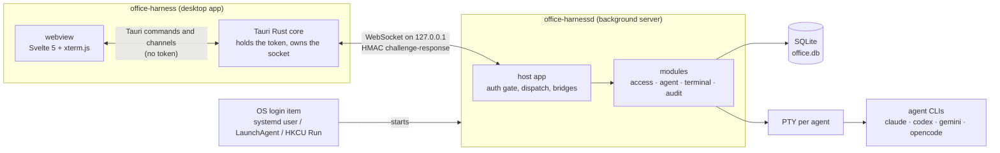
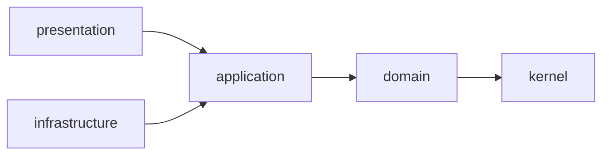
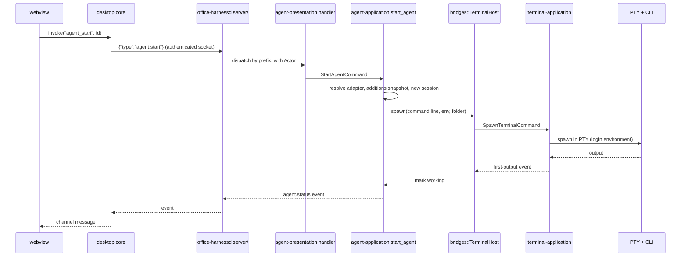

# Architecture Specification

Status: draft for the owner's review · Date: 2026-11-15. Product scope is in [PRD.md](PRD.md). The behavior contracts are the change specs under [`specs/changes/`](../specs/changes/). The design of change 0001 is beside its spec: [research.md](../specs/changes/archive/0001-office-server-and-terminal/research.md), [data-model.md](../specs/changes/archive/0001-office-server-and-terminal/data-model.md), and [contracts/client-protocol.md](../specs/changes/archive/0001-office-server-and-terminal/contracts/client-protocol.md).

Marks:
- **Decided** means that the owner made the decision.
- **Proposed** means that this document makes the decision, and it waits for the owner's review.
- **Unverified** means that the point is not confirmed yet. Check it before you rely on it.

## System Overview

office-harness has two programs that run on the user's machine:

- `office-harnessd` is the background server. It runs every agent CLI in its own pseudo-terminal (PTY), keeps the office state in one SQLite database, and serves clients over a loopback WebSocket. It runs while the user is logged in, whether or not a window is open.
- `office-harness` is the desktop app, built with Tauri v2. Its Rust core is the only process that talks to the server. Its webview (Svelte 5) shows the office and the live terminals.

Each program is a **modular monolith**: one Cargo workspace of small Rust crates, split by business module first and by Clean Architecture layer inside each module. The pattern follows one rule: modules never depend on one another, and the host app is the only place that wires them together.



**Decided** (2026-11-15):
- the stack: a Rust server, Tauri v2, xterm.js, SQLite, and a loopback WebSocket with a token;
- Svelte with TypeScript for the webview;
- the license, AGPL-3.0-or-later.

**Proposed:** everything else in this document.

## Architectural Style

**Modular monolith with Clean Architecture in each module.**

| Property | Decision |
| --- | --- |
| Deployment | Two binaries: `office-harnessd` and the Tauri app. The installer bundles the server as a Tauri sidecar. The server registers itself as a per-user login item. |
| Process model | The server is one process with one Tokio runtime. It runs each agent CLI as a child process in its own PTY. |
| Database | One SQLite file. Each module owns the tables that carry its prefix, and each module runs its own migrations. |
| Composition | Constructor injection at one composition root per program. |
| Module boundary | The Cargo dependency graph enforces it, not a runtime registry. |
| Clients | In 0001 the only client is the desktop app. Later clients (R5 remote machines) use the same protocol and the same token proof. |

## Module Pattern

Each business module is a set of separate Cargo crates, one for each Clean Architecture layer that the module uses. A layer with no content gets no crate.

| Layer | Crate name | Contents |
| --- | --- | --- |
| `domain` | `<module>-domain` | `entities/`, `value_objects/`, `enums/`, `events/`, `services/`, `errors/`, and invariants. No I/O. |
| `application` | `<module>-application` | `common/` (ports in `interfaces/`, `models/`, `errors/`), `commands/<use_case>/`, `queries/<use_case>/`, and `dtos/`. |
| `infrastructure` | `<module>-infrastructure` | `persistence/` (`repositories/`, `migrations/`) and `services/` (outbound adapters: PTY host, CLI adapters, file stores). |
| `presentation` | `<module>-presentation` | `handlers/` (one per protocol message type), `contracts/` (request, response, and event bodies), `mappings/`, and a `handlers()` entry point. |

Package names use the form `<module>-<layer>`. The Rust import path is `<module>_<layer>`. For example, the package `agent-domain` is imported as `agent_domain`.

Presentation here means the protocol surface, not a screen. A module's `presentation` crate declares which protocol messages it answers (`agent.*`, `project.*`, `terminal.*`, `token.*`). The host app owns the socket and dispatches each message to the module that owns its prefix.

### Modules

Boundaries follow the spec entities. A new module is added when a change needs a new boundary.

| Module | Owns | Change |
| --- | --- | --- |
| `access` | The office token, the challenge and proofs, token regeneration, and the owner-only file rules | 0001 (FR-007 to FR-010) |
| `agent` | Agents, projects, office additions, sessions, the status state machine, and the CLI adapters (`claude`, `codex`, `gemini`, `opencode`, generic) | 0001 (FR-012 to FR-014, FR-020 to FR-025) |
| `terminal` | PTY processes, the server-side screen emulator, the capped output store, terminal-query answers, attach, input, and resize | 0001 (FR-015 to FR-019) |
| `audit` | Action record entries: actor, target, action, time, and result | 0001 (FR-011) |
| `hierarchy` | Roles, teams, the parent tree, directives, and agent actors | 0002 |
| `notification` | Status events that the user must see, and the read and unread state | 0003 |
| `schedule` | The person's schedules: repeat and due-time rules, next due times, run history, and the schedule cap | 0025 |
| (later) `machine` | Machines that join the office from another computer | R5 |
| (later) `meeting` | Meetings with chosen agents and presets | R8 |

The R7 office scene is a webview module that reads the same entities. It needs no server module of its own.

**Cross-module needs, resolved without a module dependency:**
- **`agent` needs a running terminal.** `agent-application` declares a `TerminalHost` port (spawn, stop, and subscribe to exit and output activity). The host app implements it in `bridges/terminal_host.rs` by calling `terminal-application`. `agent` never names a `terminal` type.
- **`agent` drives its status from terminal activity.** `terminal-application` emits plain events (first output, quiet period, exit code). The bridge turns them into `agent` status commands.
- **Every module writes the action record.** Each writing module declares an `ActionRecorder` port in its own `application` crate. The host app implements it with `audit-application`.
- **The CLI adapters are `agent` infrastructure.** They build command lines and read a CLI's session list without writing anything (FR-021). They know CLIs, not terminals.

## Directory and Crate Structure

```text
office-harness/
├── Cargo.toml                                  # workspace root
├── package.json, bun.lock                      # JavaScript workspace (desktop webview)
├── docs/                                       # PRD.md, ARCHITECTURE.md
├── specs/changes/                              # change specs and their design
└── src/
    ├── kernel/                                 # shared kernel (see Kernel)
    ├── modules/
    │   ├── agent/                              # worked example
    │   │   ├── domain/src/
    │   │   │   ├── entities/                   # agent.rs, project.rs, session.rs
    │   │   │   ├── value_objects/              # agent_name.rs, office_additions.rs, env_entry.rs
    │   │   │   ├── enums/                      # agent_status.rs
    │   │   │   ├── services/                   # status_machine.rs
    │   │   │   └── errors/                     # agent_error.rs
    │   │   ├── application/src/
    │   │   │   ├── common/interfaces/          # agent_repository.rs, terminal_host.rs, cli_adapter.rs, action_recorder.rs, clock.rs
    │   │   │   ├── commands/
    │   │   │   │   ├── create_agent/           # create_agent_command.rs, _handler.rs, _validator.rs
    │   │   │   │   ├── start_agent/
    │   │   │   │   ├── stop_agent/
    │   │   │   │   ├── start_new_task/
    │   │   │   │   ├── continue_session/
    │   │   │   │   └── set_office_additions/
    │   │   │   ├── queries/                    # list_agents/, list_sessions/, get_office_additions/
    │   │   │   └── dtos/
    │   │   ├── infrastructure/src/
    │   │   │   ├── persistence/                # repositories/, migrations/
    │   │   │   └── services/
    │   │   │       ├── cli_adapters/           # claude.rs, codex.rs, gemini.rs, opencode.rs, generic.rs
    │   │   │       └── login_environment.rs    # resolves the user's login shell environment (FR-020)
    │   │   └── presentation/src/
    │   │       ├── handlers/                   # agent_create_handler.rs, session_continue_handler.rs, ...
    │   │       ├── contracts/                  # requests/, responses/, events/
    │   │       └── mappings/
    │   ├── terminal/                           # same shape; infrastructure/services/pty_host.rs, screen_emulator.rs, output_store.rs
    │   ├── access/                             # same shape; infrastructure/services/token_store.rs
    │   └── audit/                              # same shape
    │
    ├── shared/                                 # technical crates only (see Shared Technical Crates)
    │   ├── wire/                               # envelope, frame codec, HMAC proof (server and desktop)
    │   └── private-fs/                         # owner-only files and folders on Unix and Windows
    │
    └── apps/
        ├── office-harnessd/                    # the background server
        │   └── src/
        │       ├── main.rs                     # composition root, thin
        │       ├── config/                     # data folder, settings defaults, flags
        │       ├── bootstrap/                  # single-instance lock, migrations, interrupted sweep, services
        │       ├── server/                     # axum router, upgrade checks, auth gate, dispatch, event fan-out
        │       ├── bridges/                    # cross-module port adapters
        │       └── cli/                        # register, unregister, version
        └── desktop/                            # the Tauri app
            ├── src-tauri/src/                  # Rust core: connection.rs, server_process.rs, commands/, channels/
            └── src/                            # Svelte 5 webview (see Frontend Folder Structure)
```

**Rust to Clean Architecture mapping.**

| Clean Architecture | This project |
| --- | --- |
| Solution | Cargo workspace (`Cargo.toml` at the root) |
| Projects `X.Domain`, `X.Application`, `X.Infrastructure`, `X.Api` | Crates `<module>-domain`, `-application`, `-infrastructure`, `-presentation`, and the host `office-harnessd` |
| `Common/Interfaces` (ports) | `common/interfaces/` in the application crate |
| `Commands/<UseCase>` with command, handler, and validator | `commands/<use_case>/` with the same three files |
| Controllers | `handlers/`, one per protocol message type |
| `Program.cs` | `main.rs`, `config/`, `bootstrap/` |

## File Organization Inside a Crate

- **Group by kind inside a layer crate, with one folder per use case in `application`.** There is no `features/` level, because the module is already the feature boundary.
- **One type per file**, named after the type in snake_case: `create_agent_command.rs` holds `CreateAgentCommand`.
- **Every command has a validator.** Input rules live in the validator, not in the handler. A validation error names the field (the spec's edge cases).
- **Each folder's `mod.rs` is its public face.** It re-exports the folder's types, so consumers import from the folder.
- **Tests:**
  - Unit tests sit beside the code in `<name>.tests.rs`, attached with `#[cfg(test)] #[path = "..."] mod tests;`.
  - Integration tests go in each crate's `tests/` folder.

## Workspace Configuration

The root `Cargo.toml` picks up module crates by pattern, so adding a module needs no workspace edit:

```toml
[workspace]
resolver = "3"
members = [
    "src/kernel",
    "src/shared/*",
    "src/modules/*/domain",
    "src/modules/*/application",
    "src/modules/*/infrastructure",
    "src/modules/*/presentation",
    "src/apps/office-harnessd",
    "src/apps/desktop/src-tauri",
]
default-members = ["src/apps/office-harnessd"]

[workspace.package]
edition = "2024"
license = "AGPL-3.0-or-later"
publish = false
```

- **Glob members:** Cargo rejects a glob that matches no folder. Keep each glob commented out until its first crate exists.
- **Tests:** CI and every local check use `cargo test --workspace`. A plain `cargo test` only covers the default member.
- **Versions:** exact versions are fixed in `[workspace.dependencies]` when T1 of the 0001 plan confirms them.
- **Workspace lints:** `unsafe_code = "forbid"` everywhere except `src/shared/private-fs` and `terminal-infrastructure`, which need Windows API calls and say why. On top of that, clippy pedantic, plus deny for `unwrap_used`, `expect_used`, and `todo`.

## Dependency Rules

**Cardinal rule: business modules never depend on one another.** No crate of one module appears in another module's manifest.

Within a module the order is strict:



| Crate | May depend on | Must never depend on |
| --- | --- | --- |
| `kernel` | `serde`, `uuid`, `thiserror` | Any module, any app, `tokio`, `axum`, `rusqlite` |
| `<module>-domain` | `kernel`, `serde`, `thiserror`, `time` | Its own outer layers, I/O crates, any other module |
| `<module>-application` | Its own `domain`, `kernel`, `serde`, `thiserror`, `async-trait` | Its own `infrastructure` and `presentation`, `axum`, `rusqlite`, `portable-pty`, any other module |
| `<module>-infrastructure` | Its own `application` and `domain`, `kernel`, `rusqlite`, `portable-pty`, `vt100`, `tokio`, and `shared/*` | Its own `presentation`, `axum`, any other module |
| `<module>-presentation` | Its own `application` and `domain`, `kernel`, `serde`, `shared/wire` | Its own `infrastructure`, `rusqlite`, `portable-pty`, any other module |
| `shared/*` | Third-party technical crates | `kernel`, any module, any app |
| `office-harnessd` | Every module's `presentation`, `infrastructure`, and `application` (for port types while wiring), `kernel`, `shared/*`, `axum`, and `tokio` | Nothing; it is the outermost crate |
| `desktop` (`src-tauri`) | `shared/wire`, `tauri` and its plugins, `tokio` | Every module crate, `rusqlite`, `portable-pty` |

The desktop app knows only the wire protocol. It never links server code, so a later remote client (R5) has the same view of the server.

## Kernel

`src/kernel` follows the Shared Kernel pattern: a small subset of the model that several modules agree to share.

**Initial candidates:** `AgentId`, `Actor` (the user in 0001, an agent from 0002), and `Timestamp`. A type moves in only when a second module needs it.

**Admission rule.** A type enters only when all three hold:
1. At least two modules need it.
2. It is a domain concept, not a helper.
3. It changes rarely.

**Excluded outright:** helper modules (`utils`, `common`, `helpers`), ports, business rules, framework types, and catch-all error enums.

## Shared Technical Crates

`src/shared/` holds technical capabilities. It is not a layer and not a module. A crate enters only when all of these hold:

1. At least two crates need it.
2. It holds no business vocabulary.
3. It depends on no module and no app.

| Crate | Why it is shared | Users |
| --- | --- | --- |
| `wire` | The request, response, and event envelope, the binary terminal frame codec, the HMAC challenge-response proof, and the protocol version. Both ends of the socket must agree byte for byte. | `office-harnessd`, module `presentation` crates, `desktop` |
| `private-fs` | Creates files and folders that only the owner can read: mode `0600`/`0700` on Unix, and a protected access list on Windows (FR-009) | `access-infrastructure`, `terminal-infrastructure`, `office-harnessd` bootstrap |

Message bodies (`contracts/`) stay in each module's `presentation` crate. They are exported to TypeScript for the webview by a generator, so nobody copies API types by hand. The generator is open (Open Items).

## Composition Root and Request Flow

`src/apps/office-harnessd/src/main.rs` is the only place that selects concrete implementations. It stays thin:

```rust
#[tokio::main]
async fn main() -> anyhow::Result<()> {
    let config = config::load()?;
    let _instance = bootstrap::acquire_single_instance(&config)?;
    let services = bootstrap::start(&config).await?;
    server::serve(services, &config).await
}
```

**Startup order:**
1. Load the configuration and the data folder.
2. Take the single-instance lock. A second server exits with a clear message.
3. Run each module's migrations.
4. Mark the agents of an unclean stop as `interrupted` (FR-004).
5. Build the infrastructure adapters.
6. Build the use-case services with the ports injected (the bridges included).
7. Write `server.json`.
8. Bind `127.0.0.1` on a free port and serve.

### Authentication context

The full rules are in [the client protocol](../specs/changes/archive/0001-office-server-and-terminal/contracts/client-protocol.md#authentication-fr-007-fr-010).

- **Before any module code runs,** the server's `server/` layer:
  - refuses non-loopback peers;
  - refuses an upgrade with a wrong `Host` or with any `Origin`;
  - runs the mutual HMAC challenge-response through `access-application`.
- **On success,** it attaches an `Actor::User` to the connection. Module handlers read the `Actor`; they never see the token.
- **The token never crosses the socket and never enters the webview.** The desktop app's Rust core reads it from the owner-only data folder and proves knowledge of it.
- **What the token protects against:** other OS users, and programs that do not run as the owner. It is not a sandbox against an agent CLI that runs as the same user (spec 0001 A7).

### Request flow: start an agent



### Terminal attach flow

1. The webview asks the core to attach, with its size.
2. The server sends one snapshot frame, built by `terminal-infrastructure` from the server-side emulator. The frame has the scrollback rows, then the screen, then the input modes.
3. Live output frames follow.
4. Keys go back as `terminal.input`.
5. The server answers the terminal's cursor-position and device-attribute queries itself, and the webview drops xterm.js's own automatic answers, so a CLI never gets two answers.

### Cross-cutting rules

- **No CLI configuration is written (FR-021).** No crate writes into a CLI's configuration folders. Only `agent-infrastructure` reads them, and only for a session list. A test fixture checks that the folders do not change (plan 0001 T7).
- **Login environment (FR-020).** An agent starts with the user's resolved login environment, plus its office additions, minus the server's own variables.
- **No outside connections (FR-005).** No crate depends on an HTTP client. Only `desktop` opens a socket, and only to loopback.
- **Logs** hold ids, status, and error kinds. They never hold the token, terminal output, prompts, or environment values.
- **Error contract.** Every failed request returns `{"ok":false,"error":{"code","message"}}` with one of the codes `invalid`, `conflict`, `not_found`, `refused`, or `internal`. The message names the field or entry at fault.

## CQRS Organization

Commands (`commands/`) change state. Queries (`queries/`) only read, and they may return shapes made for display. Handlers call the use-case function directly. There is no mediator and no runtime dispatch by message type inside a module. The only dispatch is the host's routing by message prefix.

## Data Folder and Database

There is one data folder per OS user, chosen by the `directories` crate, with owner-only access:

```text
<data folder>/
├── office.db            # SQLite, WAL mode
├── token                # office token (access)
├── server.json          # port, pid, protocol, version, start nonce
├── server.lock          # held while the server runs
└── output/<session>.log # capped recent output (terminal)
```

- **One database file, one owner per table.** Each module's tables carry its prefix (`agent_`, `terminal_`, `audit_`, `access_`). Each module has its own migration ledger table (`<module>_schema_version`) and its own forward-only migrations, so modules stay independent. SQLite has no schemas, so this replaces the per-module schema that a server database would use. A bridge never joins tables of two modules.
- **Writes run in one transaction per command.** A full disk produces a `storage.error` event, and the agents keep running.
- **Backup and removal:**
  - Stop the server, then copy the data folder to back it up.
  - `office-harnessd unregister` removes the login item.
  - Deleting the data folder removes all office state.

## Frontend Stack

- **Shell:** the webview is a Svelte 5 single-page app, built by Vite inside Tauri v2 (**Decided:** Svelte + TypeScript).
- **Terminal:** `@xterm/xterm` with `addon-fit` and `addon-webgl`.
- **Styling (Proposed):** Tailwind CSS 4 and shadcn-svelte components copied into the repository. They are widely used with Svelte 5.
- **Talking to the server:** the webview calls Tauri commands for requests and listens on Tauri channels for events and terminal frames. It holds no token and opens no socket.
- **Accessibility:**
  - Every action works from the keyboard.
  - Focus is visible.
  - Status is text, never color alone.
  - Text contrast meets WCAG 2.2 AA (spec 0001 user experience).

## Frontend Folder Structure

The webview is modular in the same way as the server. Its feature folders use the same names as the server modules.

```text
src/apps/desktop/src/
├── boundaries.spec.ts          # import rules
├── app.svelte                  # shell: connection state, then the main view
├── modules/
│   ├── agent/
│   │   ├── index.ts            # public face for other modules
│   │   ├── views/              # agents-view.svelte, agent-details-view.svelte
│   │   ├── components/         # agent-list.svelte, agent-form.svelte, additions-editor.svelte, session-list.svelte
│   │   ├── services/           # agent.service.ts (calls core/api)
│   │   ├── state/              # agents.ts (logic, tested) + agents.store.svelte.ts (runes)
│   │   └── models/             # agent-form.model.ts
│   ├── terminal/               # terminal-view.svelte, terminal.ts (xterm wiring, query-reply filter)
│   ├── access/                 # not-authorized view, token regeneration
│   └── audit/                  # action-record.svelte
├── core/
│   ├── api/                    # invoke() and channel wrappers, error mapping
│   │   └── generated/          # TypeScript types generated from the Rust contracts
│   ├── connection/             # loading, not reachable, not authorized, version mismatch
│   └── shortcuts/              # focus-leave shortcut and its setting
├── shared/
│   ├── ui/                     # shadcn-svelte components
│   └── components/             # empty-state.svelte, confirm-dialog.svelte
└── styles/app.css
```

**Rules:**
1. **Dependency direction:** a module imports `core/`, `shared/`, its own files, and other modules' `index.ts`. `core/` may import `shared/`. `shared/` imports neither `core/` nor `modules/`.
1. **No cycles:** imports between modules go in one direction only.
2. **Types come from `core/api/generated`.** Nobody copies an API type by hand.
3. **Enforcement:** `boundaries.spec.ts` fails on a deep import into another module, a cycle, or `shared/` importing `core/` or `modules/`.
4. **File names** are kebab-case with a type suffix: `agent.service.ts`, `agents.store.svelte.ts`.

## Desktop Core

`src/apps/desktop/src-tauri` is the only bridge between the webview and the server.

- **`connection.rs`:**
  - reads `server.json` and the token;
  - opens the socket and runs the proof;
  - checks that the server proves itself;
  - checks the protocol number and the version;
  - reconnects with backoff;
  - forwards requests and events.
- **`server_process.rs`:**
  - starts the server through its login item, or as a detached process, so that the server outlives the app (FR-001, FR-026);
  - runs `register` on first start.
- **Capabilities** grant the webview only the commands and channels that it uses. A strict content security policy applies, and the webview renders no raw HTML.

## Incremental Build Isolation

Changing a crate rebuilds that crate and the crates that depend on it. Modules never depend on one another, so a change stays inside one module plus the host app:

| Change | Rebuilt | Fresh |
| --- | --- | --- |
| `agent-domain` | the `agent` crates and `office-harnessd` | `kernel`, the other modules, `desktop` |
| `terminal-infrastructure` | `terminal-infrastructure` and `office-harnessd` | everything else |
| `shared/wire` | `wire`, all `presentation` crates, `office-harnessd`, and `desktop` | domain, application, and infrastructure crates |
| `kernel` | every crate that depends on it | third-party crates |

## Testing Strategy and Boundary Enforcement

| Level | Location | What it covers |
| --- | --- | --- |
| Domain unit | `<module>-domain` | The status machine, value objects, and validation. No I/O. |
| Application unit | `<module>-application` | Commands and queries with in-memory port fakes, including `TerminalHost` and `CliAdapter` fakes |
| Infrastructure integration | `<module>-infrastructure/tests/` | Migrations, repositories on a temporary SQLite file, the PTY host with a test CLI, screen snapshots, the CLI adapters with fake CLIs on `PATH`, and the CLI configuration folders staying unchanged |
| Presentation | `<module>-presentation/tests/` | Message decoding, error codes, and mappings with mocked services |
| Server end to end | `office-harnessd/tests/` | The real binary, a temporary data folder, and a `wire` test client: auth, dispatch, events, and terminal frames |
| Webview | `bun test` beside `.ts` files, plus Playwright with `@axe-core/playwright` against the Vite build with a mocked core | Logic, import boundaries, views, and accessibility |
| Real surface | By hand on Linux, macOS, and Windows | The four real CLIs, login start, and the 0001 success criteria |

`cargo test --workspace` runs every Rust level. CI runs all levels on Linux, macOS, and Windows.

**Boundary enforcement:**
- The Cargo graph is the primary check: a forbidden dependency is a manifest error.
- `scripts/check-boundaries.sh` (with `--self-test`) runs `cargo metadata` in CI and asserts all of these:
  1. No `*-domain` or `*-application` crate lists `axum`, `rusqlite`, `portable-pty`, `vt100`, or `tokio::fs` users.
  2. No `*-presentation` crate lists `rusqlite` or `portable-pty`.
  3. No module crate lists another module's crate.
  4. `kernel` and `shared/*` list no module crate.
  5. `desktop` lists no module crate.

## Extension Points for Later Releases

These are not built in 0001. The structure leaves room for them:

- **R5 distributed machines:** a `machine` module, and a TLS listener in the host app next to the loopback one. Remote clients use the same `wire` protocol and the same token proof. Each agent already belongs to a machine (data model).
- **R7 office scene:** a webview module that reads agents, roles, and statuses. It needs no server change.
- **R8 meeting room:** a `meeting` module that sends each brief to a participant's terminal through the terminal port and reads terminal output through ports. It does not send 0002 directives: spec 0004 and its plan do not depend on 0002.
- **Docker Compose:** the container runs `office-harnessd` and the agent CLIs. It needs the R5 listener first, because the 0001 server accepts loopback only.

## Open Items

1. **TypeScript type generation from Rust contracts:** `ts-rs` or `specta`. Choose in plan T2. **Unverified:** which of them fits Tauri channels best.
2. **Tailwind CSS 4 and shadcn-svelte:** **Proposed**, it is widely used with Svelte 5. The owner may choose plain CSS instead.
3. **Module split:** `agent` owns sessions and the CLI adapters. If sessions grow (0002 directives, R8 meetings), a `session` module can split out behind the same ports.
4. **Windows `unsafe` code:** it is limited to `private-fs` and `terminal-infrastructure`. Each block carries a safety comment and a test.
